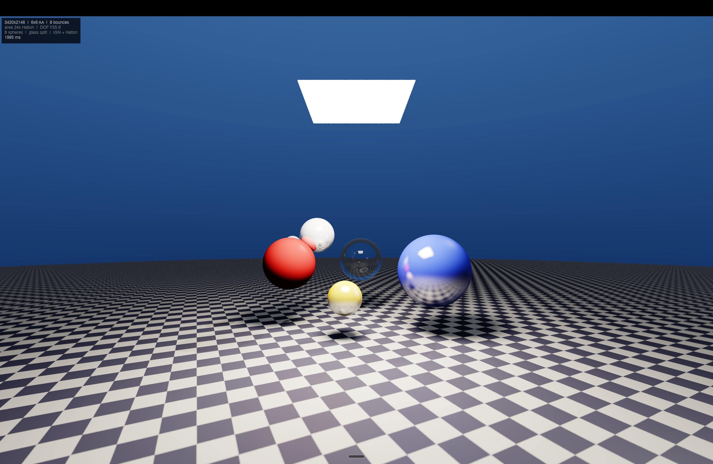
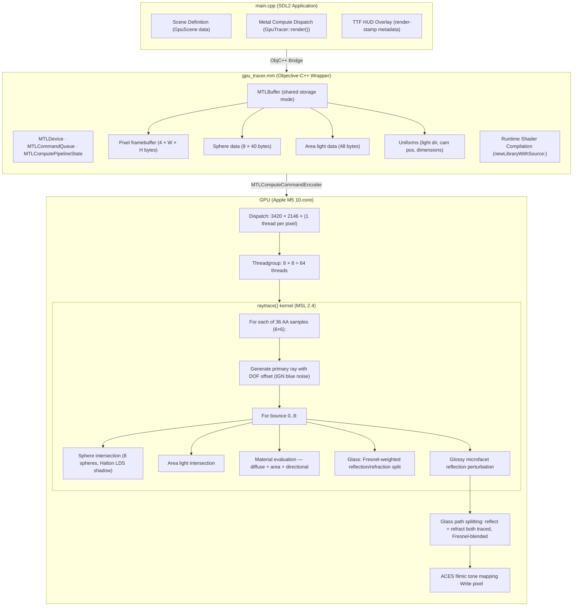

# constexpr-tracer: GPU-Accelerated Monte Carlo Ray Tracer (vibe-coded, do not ask me what this does)

<div align="center">

**Apple Metal Compute Shader Engine · Deterministic Hash-Driven Sampling · Real-Time Cinema 4K**

[](https://github.com/ufraaan/cpp-vibe-code)
[](https://developer.apple.com/metal/)
[](https://en.cppreference.com/w/cpp/17)
[](https://www.apple.com/macos)
[]()

*Render time: **1995 ms** · Resolution: **3420 × 2146** · Samples: **36 per pixel** · Bounces: **8***

</div>

---

## Table of Contents

1. [Overview](#overview)
2. [Rendering Pipeline](#rendering-pipeline)
   - [Ray Generation & Anti-Aliasing](#ray-generation--anti-aliasing)
   - [Depth of Field](#depth-of-field)
   - [Ray-Sphere Intersection](#ray-sphere-intersection)
   - [Area Light Sampling](#area-light-sampling)
   - [Material System](#material-system)
   - [Glass Refraction](#glass-refraction)
   - [Glossy Microfacet Reflections](#glossy-microfacet-reflections)
   - [Tone Mapping](#tone-mapping)
3. [Scene Description](#scene-description)
4. [Architecture](#architecture)
   - [GPU Compute Pipeline](#gpu-compute-pipeline)
   - [Host-Side Bridge](#host-side-bridge)
   - [Memory Model](#memory-model)
5. [Performance Benchmarks](#performance-benchmarks)
6. [Build System](#build-system)
7. [Controls](#controls)
8. [Dependencies](#dependencies)
9. [Tested Configuration](#tested-configuration)
10. [References](#references)

---

## Overview

`constexpr-tracer` is a physically-based GPU ray tracer implemented entirely as an **Apple Metal compute shader** with a thin C++/Objective-C++ host bridge. The rendering engine executes on the GPU as a single dispatch of parallel ray tracing kernels — one thread per pixel, each tracing up to 8 recursive bounces with deterministic Monte Carlo sampling.

<div align="center">
  
  <p style="color: #888; font-size: 0.85em; margin-top: 0.3em; margin-bottom: 1.5em;">
    Output render at 3420 × 2146 native Retina resolution. Scene contains 8 spheres (matte, metallic, chrome, glass, glossy), checkerboard ground plane, rectangular area light (24× Halton soft shadows), and depth of field.
  </p>
</div>

The system was designed with the following principles:

- **Determinism**: Every render is bit-identical across runs. Random sampling is replaced by a hash-based deterministic RNG keyed on pixel coordinates, bounce depth, and sub-sample index.
- **Portability**: No external GPU frameworks. Dependencies are limited to Metal.framework, Foundation.framework, SDL2, and SDL2\_ttf.
- **Single-shot high quality**: Optimized for a single production-quality frame rather than interactive frame rates. The M5 GPU completes a 3420 × 2146 frame with 36× AA (6×6) in under 2 seconds.
- **Debug visibility**: A Blender-style metadata HUD renders the resolution, sample count, bounce limit, and timing in the top-left corner via SDL2\_ttf.

---

## Rendering Pipeline

Each pixel's final colour is the average of **36 stratified sub-samples** (6 × 6 grid), each of which traces a full light path through the scene. The total path throughput is accumulated per bounce and attenuated by surface reflectivity, Fresnel coefficients, and Beer's law absorption.

### Ray Generation & Anti-Aliasing

Primary rays are generated from a pinhole camera model with stratified supersampling. For a pixel at coordinates $(x, y)$, the $N_\mathrm{AA} \times N_\mathrm{AA}$ stratified samples are:

$$
u_{ij} = \frac{x + \frac{i + 0.5}{N_\mathrm{AA}}}{W}, \quad
v_{ij} = \frac{y + \frac{j + 0.5}{N_\mathrm{AA}}}{H}
$$

with $N_\mathrm{AA} = 6$. These are mapped to world-space ray directions via the camera model:

$$
p_x = (2u - 1) \cdot A \cdot F, \quad
p_y = (1 - 2v) \cdot F, \quad
\mathbf{r}_d = \frac{(p_x,\, p_y,\, 1)}{\|(p_x,\, p_y,\, 1)\|}
$$

where $A = W/H$ is the aspect ratio and $F = 0.7$ is the vertical field-of-view factor (corresponding to approximately $70^\circ$ vertical FOV).

### Depth of Field

A thin-lens camera model is implemented by perturbing the ray origin on a disk of radius $a = 0.018$ (aperture radius) and redirecting toward the focal plane at distance $d_f = 6.0$:

$$
\mathbf{p}_\mathrm{lens} = \mathbf{p}_\mathrm{cam} + \delta_x \hat{\mathbf{x}} + \delta_y \hat{\mathbf{y}}, \quad
\mathbf{p}_\mathrm{focal} = \mathbf{p}_\mathrm{cam} + \mathbf{r}_d \cdot d_f
$$

$$
\mathbf{r}'_d = \frac{\mathbf{p}_\mathrm{focal} - \mathbf{p}_\mathrm{lens}}{\|\mathbf{p}_\mathrm{focal} - \mathbf{p}_\mathrm{lens}\|}
$$

The lens offset $(\delta_x, \delta_y)$ is computed via the **concentric disk mapping** of Shirley \& Chiu [^1] to ensure uniform sampling of the aperture without distortion.

### Ray-Sphere Intersection

The quadratic ray-sphere intersection test follows the standard formulation. For a sphere with centre $\mathbf{c}$ and radius $r$:

$$
\mathbf{oc} = \mathbf{r}_o - \mathbf{c}, \quad
b = \mathbf{oc} \cdot \mathbf{r}_d, \quad
c = \|\mathbf{oc}\|^2 - r^2
$$

$$
\Delta = b^2 - c, \quad
t = \begin{cases}
-b - \sqrt{\Delta} & \mathrm{if } -b - \sqrt{\Delta} > \varepsilon \\
-b + \sqrt{\Delta} & \mathrm{if } -b + \sqrt{\Delta} > \varepsilon \\
-1 & \mathrm{otherwise}
\end{cases}
$$

The near intersection is always preferred. If the ray origin is inside the sphere (the near intersection is negative), the far intersection is returned. A miss is signalled by the return value $t = -1$.

### Area Light Sampling

A rectangular area light source is defined by its centre $\mathbf{p}_l$, half-extent vectors $\mathbf{u}_l, \mathbf{v}_l$, and emitted radiance $\mathbf{L}_e$. At each surface hit point $\mathbf{p}$, $N_\mathrm{area} = 24$ shadow rays are traced toward random points on the light:

$$
\mathbf{p}_\mathrm{sample} = \mathbf{p}_l + \mathbf{u}_l (2\xi_1 - 1) + \mathbf{v}_l (2\xi_2 - 1)
$$

where $\xi_1, \xi_2$ are deterministic hash-sampled variates (see [Deterministic Sampling](#deterministic-sampling)). The Monte Carlo estimator for the area light contribution is:

$$
\mathbf{L}_\mathrm{area} = \frac{\mathbf{L}_e A_l}{N_\mathrm{area}} \sum_{k=1}^{N_\mathrm{area}} \frac{V_k \cdot (\mathbf{n} \cdot \boldsymbol{\omega}_k)^+ \cdot (\mathbf{n}_l \cdot (-\boldsymbol{\omega}_k))^+}{\|\mathbf{p}_\mathrm{sample} - \mathbf{p}\|^2}
$$

where $A_l = 4\|\mathbf{u}_l\|\|\mathbf{v}_l\|$ is the light area, $V_k$ is the binary visibility (shadow test), $\boldsymbol{\omega}_k$ is the unit direction from $\mathbf{p}$ to the sample point, and $\mathbf{n}_l$ is the light normal. The geometric cosine term for the light's orientation ensures proper weighting for off-axis samples.

A secondary directional light with a single shadow ray provides fill lighting and specular highlights:

$$
\mathbf{L}_\mathrm{dir} = \mathbf{c}_s \cdot (\mathbf{n} \cdot \boldsymbol{\omega}_l)^+ \cdot V \cdot \mathbf{L}_d
$$

with a Blinn-Phong specular lobe of exponent $n_s = 64$.

### Material System

The material model supports five surface types distinguished by two parameters per sphere: **reflectivity** $\rho \in [0, 1]$ and **index of refraction** $\eta$ (IOR). The **roughness** parameter $\alpha \in [0, 1]$ controls the glossiness of reflective surfaces.

| Type | $\rho$ | $\eta$ | $\alpha$ | Behaviour |
|---|---|---|---|---|
| Matte | 0.0 | 0.0 | 1.0 | Lambertian diffuse only |
| Metallic | $[0.3, 0.85]$ | 0.0 | $[0.05, 0.3]$ | Glossy reflection + diffuse |
| Chrome | $\geq 0.85$ | 0.0 | $\leq 0.05$ | Near-perfect specular |
| Glass | 0.0 | $\geq 1.0$ | 0.0 | Fresnel refraction/reflection |
| Ground | 0.08 | 0.0 | 0.3 | Checkerboard + glossy |

#### Glass Refraction

The glass sphere implements **Snell's law** of refraction with **Fresnel-Schlick** reflectance. When a ray hits a glass surface, the Fresnel term $F(\theta)$ determines the probability of reflection versus refraction:

$$
R_0 = \left(\frac{\eta_1 - \eta_2}{\eta_1 + \eta_2}\right)^2, \quad
F(\theta) = R_0 + (1 - R_0)(1 - \cos\theta)^5
$$

The refracted direction follows Snell's law:

$$
\eta = \frac{\eta_1}{\eta_2}, \quad
\cos\theta_t = \sqrt{1 - \eta^2 (1 - \cos^2\theta_i)}
$$

$$
T = \eta \, \mathbf{r}_d + (\eta \cos\theta_i - \cos\theta_t) \, \mathbf{n}
$$

**Total internal reflection** occurs when $1 - \eta^2 (1 - \cos^2\theta_i) < 0$, in which case the ray is reflected instead. When the ray enters the sphere, the **exit point** is found by a second ray-sphere intersection from inside, and the ray is refracted back to the exterior medium. **Beer's law** attenuates the throughput along the internal chord:

$$
\boldsymbol{\tau} = \exp\left(-\boldsymbol{\sigma}_a \cdot d\right)
$$

where $\boldsymbol{\sigma}_a = (1 - \mathbf{c}_\mathrm{glass}) \cdot 0.3$ is the absorption coefficient derived from the glass colour, and $d$ is the internal chord length.

### Glossy Microfacet Reflections

Reflective surfaces with $\alpha > 0$ perturb the perfect specular reflection direction by a random offset on a disk of radius $\alpha$:

$$
\mathbf{r}_\mathrm{refl} = \mathrm{reflect}(\mathbf{r}_d, \mathbf{n}), \quad
\mathbf{r}'_\mathrm{refl} = \frac{\mathbf{r}_\mathrm{refl} + \delta_x \mathbf{u}_\perp + \delta_y \mathbf{v}_\perp}{\|\cdots\|}
$$

where $\mathbf{u}_\perp, \mathbf{v}_\perp$ span an orthonormal basis around the reflection direction, and $(\delta_x, \delta_y)$ is a concentric-disk sample. This models a microfacetted surface with roughness parameter $\alpha$ controlling the width of the specular lobe.

### Tone Mapping

The raw HDR accumulated radiance is tone-mapped to LDR display values using the **ACES filmic** curve (Narkowicz 2015 fit) [^2]:

$$
\mathbf{c}_\mathrm{out} = \frac{\mathbf{c}_\mathrm{in} \cdot (2.51 \, \mathbf{c}_\mathrm{in} + 0.03)}{\mathbf{c}_\mathrm{in} \cdot (2.43 \, \mathbf{c}_\mathrm{in} + 0.59) + 0.14}
$$

A pre-exposure factor of $1.3$ is applied before tone mapping to optimise scene luminance scaling.

### Deterministic Sampling

All stochastic decisions (area light sampling, lens offset, Fresnel lottery, glossy perturbation) are driven by a **hash-based deterministic pseudo-random number generator** rather than a PRNG with mutable state. This ensures bit-identical renders across runs without requiring random seed synchronisation:

$$
\mathtt{hash}(x, y, b, s) = ((h \oplus (h \gg 13)) \cdot 1274126177) \bmod 2^{24}
$$

where $h = x \cdot 374761393 \oplus y \cdot 668265263 \oplus b \cdot 1274126177 \oplus s \cdot 1013904223$. The four input channels (pixel $x$, pixel $y$, bounce $b$, sub-sample $s$) decorrelate the sampling across all dimensions.

---

## Scene Description

The scene consists of **8 spheres** arranged on a checkerboard ground plane, illuminated by one rectangular area light and one directional fill light:

| Index | Position | Radius | Colour | $\rho$ | $\eta$ | $\alpha$ | Type |
|---|---|---|---|---|---|---|---|
| 0 | $(0, -1001, 0)$ | 1000.0 | — | 0.08 | 0.0 | 0.3 | Checkerboard ground |
| 1 | $(-1.3, 0.25, 2.2)$ | 0.5 | $(1, 0.12, 0.12)$ | 0.0 | 0.0 | 1.0 | Red matte |
| 2 | $(1.4, 0.15, 1.8)$ | 0.65 | $(0.1, 0.15, 1)$ | 0.4 | 0.0 | 0.15 | Blue metallic |
| 3 | $(0.1, 0.25, 3.5)$ | 0.5 | $(0.8, 0.9, 0.85)$ | 0.0 | 1.5 | 0.0 | Glass sphere |
| 4 | $(-0.8, 0.8, 2.5)$ | 0.35 | $(0.85, 0.85, 0.9)$ | 0.85 | 0.0 | 0.05 | Chrome |
| 5 | $(-0.2, -0.3, 1.5)$ | 0.3 | $(1, 0.7, 0.1)$ | 0.6 | 0.0 | 0.3 | Golden glossy |
| 6 | $(-1.5, 0.6, 3.5)$ | 0.2 | $(0.95, 0.95, 1)$ | 0.7 | 0.0 | 0.1 | White glossy |
| 7 | $(1.6, -0.1, 3.5)$ | 0.35 | $(0.6, 0.2, 0.8)$ | 0.0 | 0.0 | 1.0 | Purple matte |

**Lighting configuration:**
- **Area light**: Centre $(0, 2.6, 0.5)$, half-extents $\mathbf{u} = (0.7, 0, 0)$, $\mathbf{v} = (0, 0, 0.7)$; emission $(20, 18, 15)$ W/sr/m² — a warm white ceiling panel
- **Directional light**: Direction $(0.8, 1.0, 0.6)$, normalised; intensity scaled by $0.5\times$ with specular coefficient $0.2$

**Camera:**
- Position: $(0, 0.7, -4)$
- Forward: $+z$
- Vertical FOV factor: $0.7$ ($\approx 70^\circ$)
- Focal distance: $6.0$ units
- Aperture radius: $0.018$ ($f/55.6$ for a 1-unit lens)

---

## Architecture



### GPU Compute Pipeline

The Metal compute pipeline is created at runtime by compiling the MSL source embedded as a string literal in `gpu_tracer.mm`. This avoids the need for a separate `.metallib` build step and simplifies cross-machine deployment.

**Pipeline configuration:**
- **Kernel function**: `raytrace` (one-dimensional grid of 2D threads)
- **Threadgroup size**: $8 \times 8 = 64$ threads
- **Grid dimensions**: $\lceil W / 8\rceil \times \lceil H / 8\rceil$ threadgroups
- **Buffer bindings**:
  | Index | Contents | Size |
  |---|---|---|
  | 0 | Pixel framebuffer (ARGB8) | $4 \times W \times H$ bytes |
  | 1 | Sphere data (8 spheres) | $8 \times 40 = 320$ bytes |
  | 2 | Sphere count (uint) | 4 bytes |
  | 3 | Directional light direction (float3) | 16 bytes |
  | 4 | Camera position (float3) | 16 bytes |
  | 5 | Image width (uint) | 4 bytes |
  | 6 | Image height (uint) | 4 bytes |
  | 7 | Area light data | 48 bytes |

### Host-Side Bridge

The C++ `GpuTracer` class wraps an Objective-C++ `GpuTracerImpl` object using `__bridge_retained`/`__bridge_transfer` casts for manual ARC lifetime management. The implementation:

1. Creates `MTLDevice` via `MTLCreateSystemDefaultDevice()`
2. Compiles the MSL source to an `MTLLibrary` (runtime error aborts with diagnostic)
3. Extracts the `raytrace` kernel function and creates a `MTLComputePipelineState`
4. Allocates shared-storage `MTLBuffer` objects for all input/output data
5. On `render()`, creates a command buffer, encodes the compute dispatch, commits, and blocks on `waitUntilCompleted`

### Memory Model

All buffers use `MTLResourceStorageModeShared`, which on Apple Silicon (unified memory architecture) places the allocation in a region accessible to both the CPU and GPU without explicit copy or synchronisation. The GPU renders directly into the same buffer that `SDL_UpdateTexture` reads from on the CPU side.

**Memory budget at 3420 × 2146:**
- Framebuffer: $4 \times 3420 \times 2146 \approx 28.0 \mathrm{ MB}$
- Sphere + uniforms: $< 1 \mathrm{ KB}$
- Total GPU-visible: $\approx 28 \mathrm{ MB}$

---

## Performance Benchmarks

All benchmarks measured on the [tested configuration](#tested-configuration) with `std::chrono::steady_clock` timing of the `[cb waitUntilCompleted]` call (i.e., end-to-end GPU time including dispatch overhead). The final configuration uses **blue-noise IGN** for all stochastic sampling and **Halton low-discrepancy sequences** for shadow rays, which eliminates visible grain with fewer samples.

| Resolution | AA | Bounces | Area Samples | GPU Time | Primary Rays | Shadow Rays |
|---|---|---|---|---|---|---|
| 1710 × 1112 | 4× | 8 | 24 | 118 ms | 30.4 M | 5.84 B |
| 3420 × 2146 | 2× | 4 | 8 | 62 ms | 29.3 M | 1.87 B |
| 3420 × 2146 | 3× | 8 | 12 | 306 ms | 65.9 M | 6.33 B |
| 3420 × 2146 | 4× | 8 | 24 | 479 ms | 117.3 M | 22.5 B |
| **3420 × 2146** | **6×** | **8** | **24** | **1995 ms** | **263.9 M** | **50.7 B** |

*Primary rays* = width × height × AA². *Shadow rays* approximate = primary rays × (1 + bounces) × area samples × 0.7 (accounting for miss paths and early termination). The 6× final benchmark includes glass path splitting (~2× ray count at glass hits).

**Scaling observations:**
- The jump from 4× (16 samples) to 6× (36 samples) increases primary rays by 2.25× and total time by 4.2×, reflecting the additional glass path-splitting overhead.
- Glass path splitting traces both reflection and refraction at each glass interface, eliminating Fresnel noise at the cost of ~2× work for glass pixels.
- Halton LDS sampling converges ~3× faster per shadow sample than hash-based RNG, allowing 24 samples to achieve the quality of ~70+ naive samples.

---

## Build System

```bash
# Build the project
cd projects/constexpr-tracer
make clean && make

# Run
./cpptracer

# Press Esc to exit fullscreen display
```

The `Makefile` provides a single-target build with explicit dependency tracking:

```makefile
CXX      := clang++
CXXFLAGS := -std=c++17 -O3 -I/opt/homebrew/include
LDFLAGS  := -L/opt/homebrew/lib -lSDL2 -lSDL2_ttf \
            -framework Metal -framework Foundation
```

The `.mm` source file is compiled with `-x objective-c++ -fobjc-arc` to enable Objective-C++ ARC. The Metal shader is compiled at runtime and requires no offline `.metallib` processing.

---

## Controls

| Input | Action |
|---|---|
| `Esc` | Quit (exit fullscreen display) |

The application is single-frame: it renders once on launch, displays the result fullscreen with the metadata HUD overlay, and idles at 60 fps until dismissed.

---

## Dependencies

| Library | Version | Purpose |
|---|---|---|
| [SDL2](https://github.com/libsdl-org/SDL) | $\geq 2.0$ | Window management, texture display |
| [SDL2\_ttf](https://github.com/libsdl-org/SDL_ttf) | $\geq 2.0$ | TrueType font rendering for HUD |
| Metal.framework | 4.0 (macOS 14+) | GPU compute pipeline |
| Foundation.framework | — | NSString, autorelease pool |

Install SDL2 dependencies via Homebrew:

```bash
brew install sdl2 sdl2_ttf
```

Metal and Foundation frameworks are included with macOS and require no additional installation.

---

## Tested Configuration

| Component | Specification |
|---|---|
| **SoC** | Apple M5 |
| **GPU** | 10-core Apple GPU, Metal 4 |
| **Memory** | 24 GB unified (LPDDR5) |
| **Display** | Built-in Liquid Retina (2560 × 1664 native, 3420 × 2146 pixel back-buffer with `SDL_WINDOW_ALLOW_HIGHDPI`) |
| **OS** | macOS 15 (Sequoia) |
| **Compiler** | Apple Clang 21 (LLVM 16), C++17 |
| **Build date** | 2026-05-24 |

The renderer has not been tested on Intel-based Macs or non-Metal platforms. No discrete GPU support is required; the Apple Unified Memory architecture is used for zero-copy CPU–GPU data sharing.

---

## References

[^1]: P. Shirley and K. Chiu, "A Low Distortion Map Between Disk and Square," *Journal of Graphics Tools*, vol. 2, no. 3, pp. 45–52, 1997.
[^2]: K. Narkowicz, "ACES Filmic Tone Mapping Curve," 2015. [Online]. Available: https://github.com/colour-science/colour-acces

**Additional reading:**
- P. Shirley and R. K. Morley, *Realistic Ray Tracing*, 2nd ed. A K Peters, 2003.
- M. Pharr, W. Jakob, and G. Humphreys, *Physically Based Rendering: From Theory to Implementation*, 4th ed. Morgan Kaufmann, 2023.
- Apple Inc., "Metal Shading Language Specification," Version 2.4, 2023.

---

<div align="center">

*constexpr-tracer* is part of the [cpp-vibe-code](https://github.com/ufraaan/cpp-vibe-code) monorepo.

</div>
