# hector

Header-only vector similarity search — C++20, SIMD-accelerated distance computation, L2/cosine/inner-product metrics.

## Features

| Feature | Description |
|---|---|
| **Header-only** | Drop `include/hector/` into your project, `#include <hector/hector.hpp>` |
| **SIMD distance** | NEON on ARM64, scalar fallback elsewhere |
| **3 metrics** | L2, cosine, inner product — selected at compile time via policy template |
| **Flat index** | Brute-force exact search, perfect recall |
| **IVF index** | Inverted file index with k-means++ clustering, tunable `nprobe` |
| **Serialization** | Save/load to binary streams with auto-detecting type tag |
| **CLI tool** | `build` and `query` subcommands for quick experimentation |

## C++ features showcased

- **Concepts** — `metric` concept constraining template parameters to valid distance metrics
- **constexpr if** — compile-time dispatch between L2/cosine/inner-product without virtual dispatch
- **Template policy-based design** — metric tags as compile-time policies
- **RAII** — all memory owned by `std::vector`; save/load use RAII streams
- **`std::span`** — bounds-safe views into vector data without copies
- **`noexcept`** — all hot paths are noexcept; error handling via file-scope asserts
- **`if constexpr` + `std::is_same_v`** — tag-based compile-time branching in `distance()`
- **SIMD intrinsics** — [ARM NEON](https://developer.arm.com/architectures/instruction-sets/intrinsics/) for explicit vectorisation (vld1q_f32 / vmlaq_f32 / vaddvq_f32)
- **Template specialization dispatch** — 6 index × metric combinations auto-detected at load time via a 4-byte tag

## Build

```bash
cd projects/hector
make
./hector --help
```

Requires a C++20 compiler. Tested with Apple Clang on arm64 (M5).

## Quick start

Generate 10,000 random 128-d vectors, build a flat index, and query:

```bash
# Build index
python3 -c "
import struct, random, sys
n, d = 10000, 128
sys.stdout.buffer.write(struct.pack('II', n, d))
for _ in range(n * d):
    sys.stdout.buffer.write(struct.pack('f', random.gauss(0, 1)))
" | ./hector build --type flat --dims 128 --metric l2 --output index.bin

# Query with 5 random vectors
python3 -c "
import struct, random, sys
n, d = 5, 128
sys.stdout.buffer.write(struct.pack('II', n, d))
for _ in range(n * d):
    sys.stdout.buffer.write(struct.pack('f', random.gauss(0, 1)))
" | ./hector query --index index.bin --k 10
```

IVF with 32 centroids and nprobe=4:

```bash
./hector build --type ivf --dims 128 --metric l2 --nlist 32 --output index.ivf < vectors.bin
./hector query --index index.ivf --k 10 --nprobe 4 < queries.bin
```

### IVF query pipeline

This is the query-time path used by the CLI and IVF index implementation:

```mermaid
flowchart LR
    A["hector query\n--index FILE --k N\n--nprobe M (default 1)"] --> B["Open serialized index"]
    B --> C["Read 4-byte tag\n3/4/5 = IVF + metric"]
    C --> D["Dispatch to index_ivf<Metric>::load()"]
    D --> E["Deserialize metadata\ndims, nlist, n_vectors"]
    E --> F["Load centroids, inverted lists,\nraw vectors, and ids"]
    F --> G["Recompute nearest centroid assignment\nfor each stored vector"]
    G --> H["For each query vector"]
    H --> I["Compute distance to every centroid"]
    I --> J["Sort centroids by distance"]
    J --> K["Probe top nprobe centroids\nclamped to min(nprobe, nlist)"]
    K --> L["Scan each probed inverted list"]
    L --> M["Decode vector id and compute\nquery-to-candidate distance"]
    M --> N["Collect candidate distance/id pairs"]
    N --> O["Select top-k with nth_element"]
    O --> P["Sort final results by distance"]
    P --> Q["Emit CSV rows\nquery_idx,rank,dist,id"]
```



## API

```cpp
#include <hector/hector.hpp>

// Flat index — exhaustive exact search
hector::index_flat<hector::metric_l2> idx(128);  // 128 dimensions
idx.add(vectors);        // std::span<const float>
idx.build();             // no-op for flat
auto results = idx.query(query, 10);  // top-10
// results: vector<pair<float, uint32_t>> — (distance, id)

// IVF index — approximate with k-means clustering
hector::index_ivf<hector::metric_cos> idx(128, 256);  // 128d, 256 centroids
idx.add(vectors);
idx.build();                          // runs k-means++
auto results = idx.query(query, 10, 4);  // top-10, nprobe=4

// Serialization
idx.save(std::cout);                  // binary output
auto loaded = decltype(idx)::load(std::cin);  // binary input
```

## Project structure

```
include/hector/
├── hector.hpp        # umbrella header
├── distance.hpp      # metric tags + distance() dispatch
├── index_flat.hpp    # brute-force exact index
└── index_ivf.hpp     # IVF index with k-means++
src/
└── main.cpp          # CLI — build, query
```
