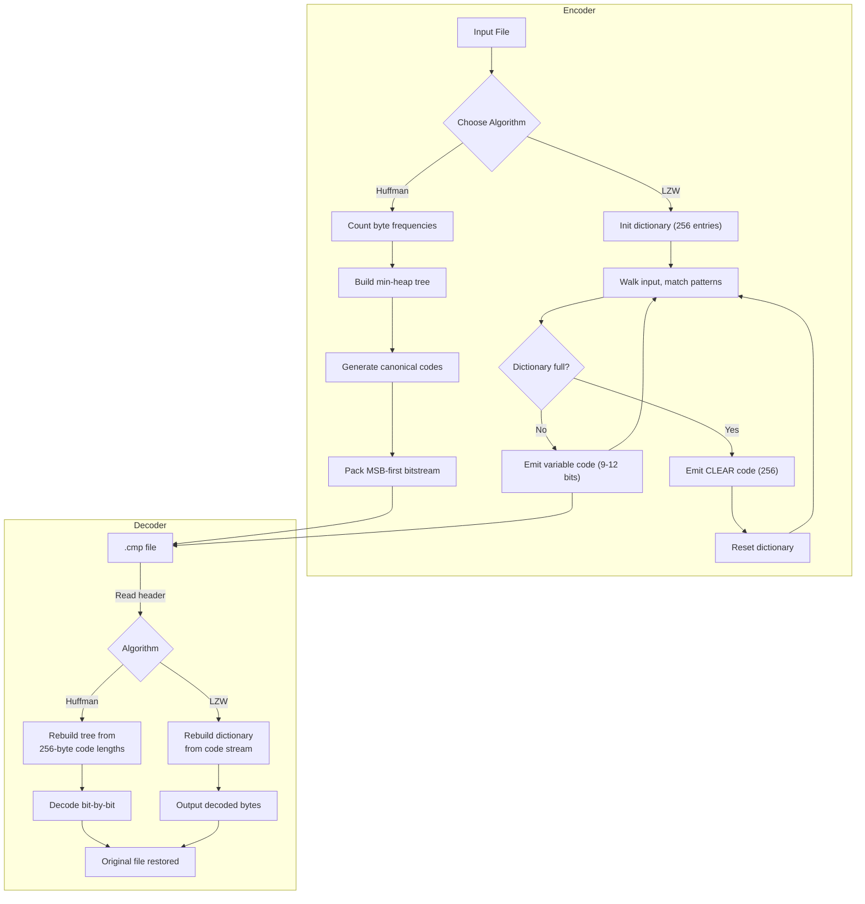

# pied-piper — LZW + Huffman File Compressor

<div align="center">

**Canonical Huffman Coding · LZW Dictionary Compression · Command-Line File Compressor**

[](https://github.com/ufraaan/cpp-vibe-code)
[](https://en.cppreference.com/w/cpp/17)
[](https://www.apple.com/macos)
[]()

</div>

A zero-dependency command-line file compressor implementing **Huffman coding** and **LZW dictionary compression** from first principles. No external libraries, no GPU, no graphics — pure C++17 file I/O and bit-level manipulation.



---

## Table of Contents

1. [Overview](#overview)
2. [Algorithms](#algorithms)
   - [Huffman Coding](#huffman-coding)
   - [LZW Compression](#lzw-compression)
3. [Usage](#usage)
4. [File Format](#file-format)
5. [Performance Benchmarks](#performance-benchmarks)
6. [Build System](#build-system)
7. [Tested Configuration](#tested-configuration)

---

## Overview

`compress` reads any file (text, binary, executable), compresses it using one of two algorithms, writes the compressed data with a minimal header, and can decompress it back to the original. A built-in benchmark mode compares both algorithms side-by-side.

**Design principles:**

- **Correctness**: Every compression is immediately verified by decompressing and checking the round-trip result matches the original.
- **Simplicity**: No external dependencies. The entire project is ~600 lines of C++17.
- **Bit transparency**: Handles arbitrary binary data. Every byte is preserved exactly.
- **Fallback**: If compression expands the file (e.g., random data), the original is stored uncompressed with a flag.

---

## Algorithms

### Huffman Coding

A **canonical Huffman coder** that:

1. Counts byte frequencies in the input
2. Builds a Huffman tree via a min-heap priority queue
3. Generates variable-length prefix codes (shorter codes for frequent bytes)
4. Converts to **canonical form** (codes sorted by length, then numerically) for a compact 256-byte header
5. Packs the bitstream MSB-first, with padding info in the header
6. Decodes bit-by-bit through a reconstructed tree

The header stores only the code length for each of the 256 byte values (0 = symbol not present). The decoder rebuilds the canonical tree, requiring no frequency table — this keeps overhead at exactly **256 bytes** plus 6 bytes of framing.

### LZW Compression

A **Lempel-Ziv-Welch dictionary coder** that:

1. Initialises the dictionary with all 256 single-byte entries
2. Walks the input, building a dictionary of repeated patterns on-the-fly
3. Outputs **variable-width codes** starting at 9 bits, growing to 12 bits as the dictionary fills
4. Emits a **clear code** (256) when the dictionary is full (4096 entries), resetting and continuing
5. Uses an **end-of-information** marker (257) to terminate the stream
6. Decoder mirrors the encoder: rebuilds the same dictionary from the code stream alone

LZW excels at repetitive data and binaries with repeated byte sequences. It does not require any precomputed statistics — the dictionary adapts as it reads.

---

## Usage

```
Usage:
  ./pied-piper <file>                      Compress (auto-select best algorithm)
  ./pied-piper -d <file.cmp>               Decompress
  ./pied-piper -b <file>                   Benchmark all algorithms
  ./pied-piper -a <algo> <file>            Compress with specific algorithm

Algorithms: huffman, lzw, auto
Output: <file>.<algo>.cmp  (compress),  <file>.cmp → <file>  (decompress)
```

### Examples

```bash
# Compress a file (auto-selects Huffman)
./pied-piper document.txt
# → document.txt.huffman.cmp

# Compress with LZW
./pied-piper -a lzw image.bin
# → image.bin.lzw.cmp

# Benchmark both algorithms
./pied-piper -b large_file.bin

# Decompress
./pied-piper -d document.txt.huffman.cmp
# → document.txt  (restored to original)
```

---

## File Format

Every compressed file begins with a 14-byte common header:

| Offset | Size | Field | Description |
|---|---|---|---|
| 0 | 4 | Magic | `"CMP1"` |
| 4 | 1 | Algorithm | `1` = Huffman, `2` = LZW |
| 5 | 1 | Flags | Bit `0`: `1` = stored uncompressed |
| 6 | 8 | Original size | Little-endian `uint64_t` |

**Huffman** (algo = 1, flags = 0):

| Offset | Size | Description |
|---|---|---|
| 14 | 256 | Code lengths (1 byte per symbol, 0 = unused) |
| 270 | 1 | Padding bits in final byte |
| 271 | — | Bit-packed Huffman codes (MSB first) |

**LZW** (algo = 2, flags = 0):

| Offset | Size | Description |
|---|---|---|
| 14 | 1 | Maximum bit width (default 12) |
| 15 | — | Variable-width LZW codes (9–12 bits, packed MSB first) |

**Stored** (flags = 1): Raw original data follows at offset 14.

---

## Performance Benchmarks

Tested on **Apple M5 (3.40 GHz)**, single-threaded, `-O3` optimisation.

### Binary Executable (57.54 KB)

| Algorithm | Compressed | Ratio | Encode | Decode | Throughput |
|---|---|---|---|---|---|
| **Huffman** | 37.29 KB | 0.6480 | 0.87 ms | 0.49 ms | 41 MB/s |
| **LZW** | **26.11 KB** | **0.4539** | 1.17 ms | 0.72 ms | 29 MB/s |

### C++ Source Code (49.36 KB)

| Algorithm | Compressed | Ratio | Encode | Decode | Throughput |
|---|---|---|---|---|---|
| **Huffman** | 31.06 KB | 0.6293 | 0.74 ms | 0.45 ms | 40 MB/s |
| **LZW** | **21.82 KB** | **0.4420** | 1.27 ms | 0.88 ms | 22 MB/s |

### Highly Repetitive Data (100 KB, all `'A'`)

| Algorithm | Compressed | Ratio | Encode | Decode | Throughput |
|---|---|---|---|---|---|
| **Huffman** | 12.47 KB | 0.1277 | 0.35 ms | 0.09 ms | 213 MB/s |
| **LZW** | **1.49 KB** | **0.0152** | 0.59 ms | 0.37 ms | 99 MB/s |

### Random Binary Data (100 KB, uniform entropy)

| Algorithm | Compressed | Ratio | Encode | Decode | Throughput |
|---|---|---|---|---|---|
| **Huffman** | 97.67 KB | 1.0001 | 2.55 ms | 0.69 ms | 29 MB/s |
| **LZW** | 97.67 KB | 1.0001 | 4.46 ms | 2.66 ms | 13 MB/s |

### Observations

- **LZW beats Huffman on all compressible data** by 30–90 %. It detects repeated multi-byte patterns that Huffman misses.
- **Huffman encodes and decodes faster** than LZW in all cases (simpler algorithm: no dictionary management).
- **LZW excels at repetitive data** — 100 KB of repeated `A` compresses to 1.49 KB (ratio 0.015) vs. Huffman's 12.47 KB (0.128).
- **Both algorithms correctly detect incompressible data** — random data is stored uncompressed (ratio ~1.0) with no size penalty beyond the 14-byte header.

---

## Build System

```bash
cd projects/pied-piper
make && ./pied-piper <file>
```

Build targets:

| Target | Description |
|---|---|
| `all` | Build the `pied-piper` binary |
| `clean` | Remove object files and binary |
| `benchmark` | Run the benchmark suite (self-test + source + binary) |

### Dependencies

- C++17 standard library (`<filesystem>`, `<chrono>`, `<queue>`, etc.)
- No external libraries, no GPU frameworks, no graphics

---

## Tested Configuration

| Component | Detail |
|---|---|
| **CPU** | Apple M5 (10-core, 3.40 GHz) |
| **RAM** | 24 GB unified |
| **OS** | macOS (arm64) |
| **Compiler** | Apple Clang 21, C++17 |
| **Optimisation** | `-O3 -Wall -Wextra` |

---

## Implementation Notes

- **Bit packing**: Both algorithms use MSB-first bit packing. The `BitWriter`/`BitReader` utilities live in `bitio.hpp`.
- **Huffman tree**: Built via `std::priority_queue` (min-heap). The single-unique-byte edge case is handled by inserting a dummy zero-frequency node.
- **LZW dictionary**: Stored as a flat `int[4096][256]` array indexed by `(prefix << 8) | char` for $O(1)$ lookup. Cleared and rebuilt on each `CLEAR` code.
- **Verification**: Every `compress()` call internally runs `decompress()` on its own output to validate roundtrip correctness. Timing for encode and decode is reported separately.
