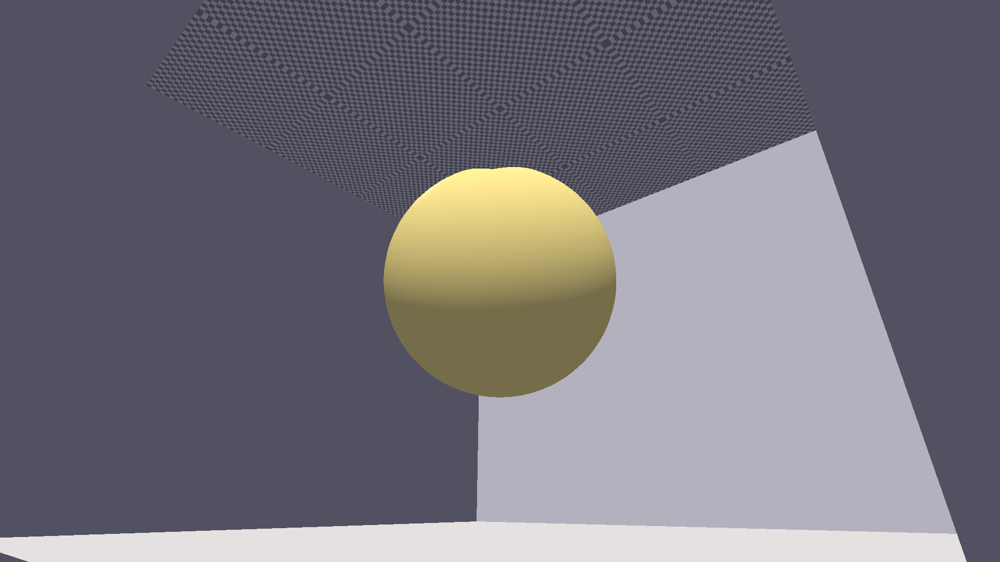
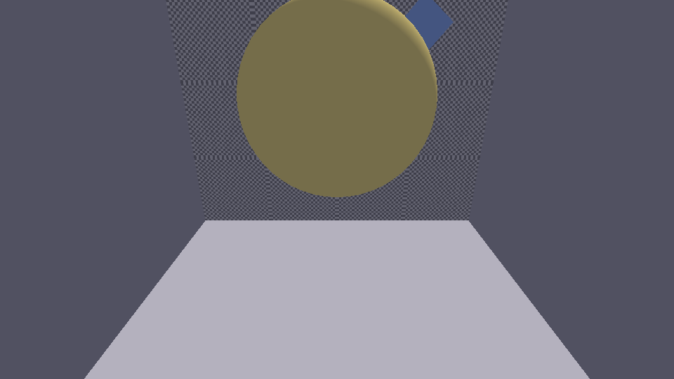
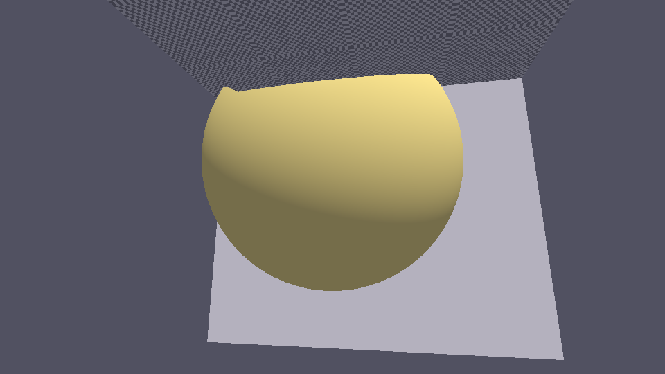

# raster

CPU-based software 3D rasterizer, written from scratch in C++17.

| | |
|---|---|
| **Language** | C++17 |
| **Dependencies** | None (standard library only) |
| **Output** | PPM (PNG via ImageMagick) |
| **Platform** | macOS (Apple Clang), ARM NEON SIMD |
| **License** | MIT |

## Features

- **Perspective projection** — configurable FOV, near/far planes
- **Vertex transformation** — model, view, projection, viewport matrices
- **Back-face culling** — screen-space signed area test
- **Barycentric rasterization** — sub-pixel precise, top-left fill rule, CW/CCW winding
- **Z-buffer** — per-pixel depth test
- **Perspective-correct interpolation** — 1/w barycentric weights
- **Blinn-Phong shading** — per-fragment diffuse + specular (power 64)
- **Bilinear texture filtering** — wrap-mode UV addressing
- **HDR framebuffer** — float colour + depth, gamma correction (2.2)

## Example Renders

**Cornell box** — golden sphere (48×48), blue rotating cube, checkerboard floor (31 tiles), directional light.

### Main view

`1920×1080`, camera at `(2.5, 1.8, 3)`



### Top-down view

`960×540`, camera at `(0.0, 3.5, 0.5)`



### Close-up

`960×540`, camera at `(0.5, 0.8, 2.5)`



## Build

```sh
git clone <repo>
cd projects/raster
make
./raster
```

Output PPM files can be converted with ImageMagick:

```sh
convert render_main.ppm render_main.png
```

## Scene

The default scene is a Cornell box with:

| Object | Material | Details |
|---|---|---|
| Back wall | `{0.7, 0.7, 0.8}` | Diffuse |
| Ceiling | `{0.8, 0.8, 0.8}` | Diffuse |
| Left wall | `{0.8, 0.3, 0.3}` | Diffuse |
| Right wall | `{0.3, 0.8, 0.3}` | Diffuse |
| Floor | Checkerboard (31 tiles, 256×256) | Bilinear filtering, UV 0–4 |
| Sphere | `{1.0, 0.85, 0.3}` gold | 48×48 segments, Phong specular |
| Cube | `{0.3, 0.5, 1.0}` blue | Rotated 0.7 rad about Y |

Lighting: directional `(0.4, -1.0, 0.6)` with ambient `(0.18, 0.18, 0.22)`.

## Implementation

- `raster.hpp` — Vec, Mat4, Color, Texture, Vertex, Framebuffer, Rasterizer declarations
- `raster.cpp` — matrix ops, texture sampling, PPM output, rasterisation, Phong shading
- `main.cpp` — scene setup, mesh generators, render loop
